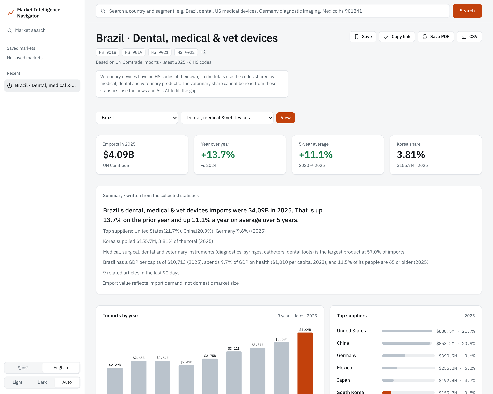
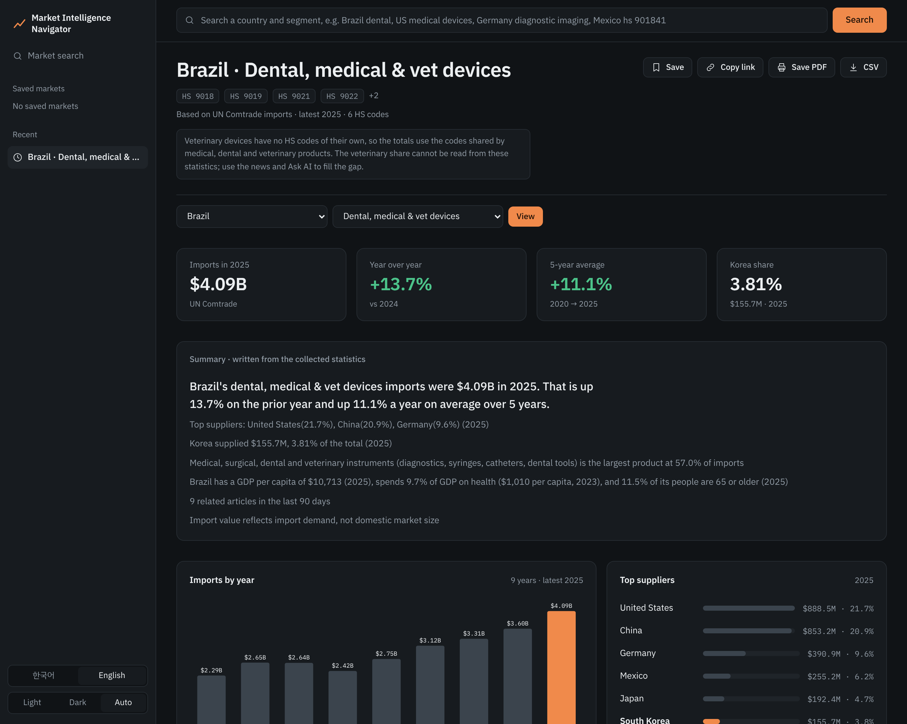
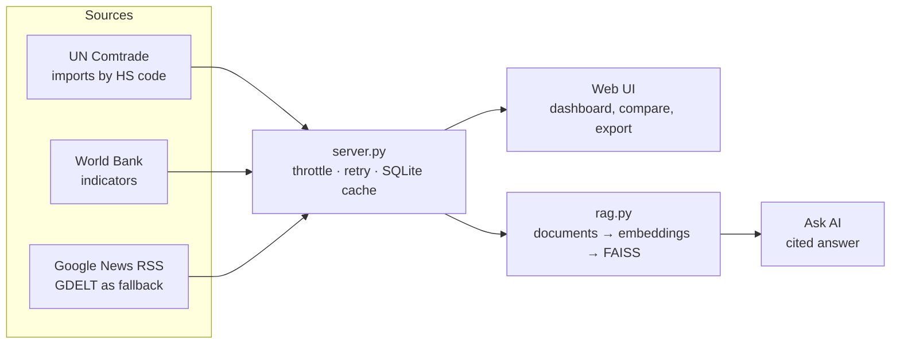
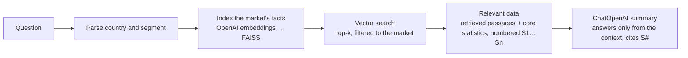

# Market Intelligence Navigator

A market research tool for exporters of **dental, medical and veterinary devices**. Type a country and a product segment ("Brazil dental", "독일 영상진단기기") and get import demand, growth, Korea's share, top suppliers, macro context and recent news on one screen, plus an evidence-grounded question-answering mode.



> **Demo video:** `docs/demo.mp4` (dashboard walkthrough). **Live demo:** _add your Render URL after deploying (see "Deploy")_. The Ask AI mode is not exposed publicly to avoid API costs; see the video.

## The problem

A sales manager at a Korean medical-device company has to decide which overseas market to approach next. Their information need is concrete:

1. How large is import demand for my product group in this country, and is it growing?
2. Who supplies it today, and where does Korea stand?
3. Is the country's health spending and population profile favourable?
4. What has been in the news in the last months (regulation, tariffs, distributors)?
5. Can I trust each number, and where did it come from?

Today these answers sit in different places: UN Comtrade or ITC Trade Map for trade, the World Bank for macro data, a news search for context, and often a consultant's PDF. Free public tools show country-level tables but do not assemble one view for a product segment, and AI answers over trade data are rarely traceable to their sources. This project builds that view and makes every statement in the AI answer point to a numbered source.

## What it does

| Area | Detail |
|---|---|
| Search | One box parses country and segment in Korean or English ("Brazil dental", "미국 의료기기", "mexico hs 9018") |
| Segments | Dental, diagnostic imaging, syringes/catheters/consumables, orthopedic/implants/hearing aids, and an all-devices view, each defined by HS codes |
| Import trend | Up to 9 years of importer-reported imports, year-over-year change, 5-year average growth |
| Korea | Korea's imports and share of the total, by year and by product |
| Suppliers | Top supplier countries with shares |
| Market overview | GDP, GDP per capita, growth, population, 65+ share, health spending (World Bank) |
| News | Recent headlines for the country and segment |
| Compare | Same segment across up to five countries |
| Workflow | Save markets, copy a shareable link, export PDF (print layout) and CSV, light/dark theme, Korean/English UI |
| Ask AI | Question → vector search → relevant data → GPT summary, with `[S1]`-style citations |



## Architecture





**Pipeline details**

* `server.py` (Python standard library only) fetches live data, respects Comtrade's rate limit (one request per 1.4 s, retry on 429) and caches responses in SQLite. A year of trade data for a market costs about 10 calls, so a new market takes roughly 30 s the first time and is instant afterwards.
* `rag.py` turns each market into small fact documents (yearly imports, per-product growth, Korea share, suppliers, macro indicators, headlines), embeds them with `text-embedding-3-small`, stores them in FAISS through LangChain and filters retrieval to the markets named in the question. Core statistics are always added to the context, flagged as "pinned", so an answer never depends on retrieval alone for the headline numbers.
* The prompt tells the model to use only the numbered context, cite every factual sentence, say what is missing, and answer in the language of the question.

## Data sources

| Source | Used for | Notes |
|---|---|---|
| [UN Comtrade](https://comtradeapi.un.org) public preview API | Imports by HS code, total and from Korea, top partners | Importer-reported, current USD; one period per request, 500-row cap |
| [World Bank](https://api.worldbank.org) WDI | `NY.GDP.MKTP.CD`, `NY.GDP.PCAP.CD`, `NY.GDP.MKTP.KD.ZG`, `SP.POP.TOTL`, `SP.POP.65UP.TO.ZS`, `SH.XPD.CHEX.GD.ZS`, `SH.XPD.CHEX.PC.CD` | Latest value can be a year or two old |
| Google News RSS, GDELT DOC 2.0 | Headlines of the last 90 days | GDELT is the fallback because it rate-limits aggressively |

HS codes per segment are defined in `server.py` (`INDUSTRIES`) and were each checked against live Comtrade data for the United States and Brazil.

## Limitations

* **Import value is not market size.** It shows import demand. Domestic production, local sales and prices are not in these statistics, and market-size figures from industry reports are mostly paid. The UI and every AI answer say so.
* **Veterinary devices cannot be isolated.** HS has no separate codes for them; they share headings (9018, 9022, 9402) with medical and dental products. The all-devices segment therefore includes veterinary trade, and the veterinary share is unknown. The UI states this on the page, and news search adds veterinary terms to compensate only partially.
* **Statistics lag.** The latest year is usually one to two years old, can be provisional, and some countries or products are unreported. The UI shows the reference year next to every figure.
* **Importer-reported data** can differ from what exporters report (freight, timing, classification). Mirror-data comparison is not implemented.
* **HS revisions** can change what a code covers across years; long series may contain breaks.
* **News is noisy and skewed.** The RSS search returns market-report press releases next to real news, leans toward English-language sources, and has no sentiment or relevance filtering.
* **The AI can still be wrong.** The evaluation below measures it; it does not make it zero.
* Check the terms of use of Comtrade and Google News before any commercial use. This is research software, not investment or legal advice.

## Evaluation

The question "does the AI use the statistics correctly?" is measured, not assumed. `eval/run_eval.py` builds **28 questions from the database itself** (4 markets × imports, year-over-year, 5-year growth, Korea share, top supplier, health spending, plus one question per market that the data cannot answer), runs each through the live pipeline and scores:

| Metric | Definition |
|---|---|
| Number match rate | Share of numbers in the answer found in the retrieved context (values are compared, so `$4.09B` equals `4,090M`) |
| Citation accuracy | Share of number-bearing sentences whose cited source really contains those numbers |
| Citation coverage / validity | Sentences that cite at all; cited ids that exist |
| Answer correct | The expected value computed from the database appears in the answer (±2%) |
| Retrieval hit rate | The vector search alone, without the pinned statistics, retrieved the right fact |
| Abstention | On unanswerable questions the answer says the data is missing |

```bash
pip install -r requirements.txt
export OPENAI_API_KEY=sk-...
python eval/run_eval.py          # writes eval/RESULTS.md and eval/results.json
python -m unittest discover -s eval -v
```

**Status.** The scoring code is covered by 9 unit tests that check it accepts grounded answers, catches invented numbers, catches a true number cited to the wrong source and handles differently formatted numbers. The scores themselves require an OpenAI key and have to be produced by running the command above; they are intentionally not filled in by hand. Known weaknesses of the method: numeric support is a proxy for factual support, abstention is detected with keywords, and 28 questions is a small sample.

## Run locally

Python 3.9 or newer. The dashboard needs no packages.

```bash
python server.py            # http://127.0.0.1:8000
```

For Ask AI:

```bash
pip install -r requirements.txt
export OPENAI_API_KEY=sk-...     # Windows: set OPENAI_API_KEY=sk-...
python server.py
```

Environment variables: `MI_CHAT_MODEL` (default `gpt-4o-mini`), `MI_EMBED_MODEL` (default `text-embedding-3-small`), `MI_TOP_K` (default 8), `PORT`, `HOST`.

## Deploy the dashboard (public demo)

The public build serves a frozen snapshot of real data (`demo/demo_cache.sqlite`, created by `python warm_cache.py`), disables every LLM endpoint so no API cost can occur, restricts requests to the built-in segments and rate-limits clients.

1. Push this repository to GitHub.
2. On [Render](https://render.com), choose New → Blueprint and select the repository (`render.yaml` and `Dockerfile` are included). The free plan sleeps when idle, so the first request after a pause is slow.
3. Put the resulting URL at the top of this README.

Locally: `MI_PUBLIC=1 python server.py`.

## Repository layout

```
server.py          HTTP server, data sources, cache, public mode
rag.py             documents, FAISS index, retrieval, cited answer
warm_cache.py      collects the demo snapshot
static/index.html  the whole UI
eval/              question builder, metrics, runner, unit tests
demo/              snapshot used by the public demo
docs/              screenshots, demo script
```

## Roadmap

A market-ranking page (product → most promising countries, with transparent and adjustable scoring), tariff and registration documents in the RAG index, veterinary-specific indicators, and a mirror-data check against Korea's own export statistics.
